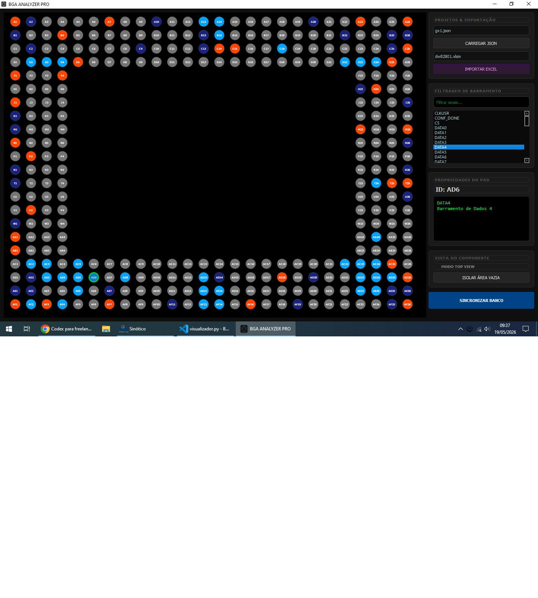

# BGA Curve Mapper

[](https://github.com/MauricioApCastro/Bga-Curver-Mapper/actions/workflows/ci.yml)


Aplicativo desktop para **visualizar, importar e editar mapeamentos de pinagem BGA** (Ball Grid Array), feito para técnicos de eletrônica que fazem diagnóstico, reparo e engenharia reversa de placas.

Um projeto [MAC Tecnology](https://mactecnology.com.br).



## Funcionalidades

- **Grade BGA interativa:** cada pad é desenhado com cor por tipo de sinal, com destaque do sinal selecionado.
- **Vista superior e inferior** (top / bottom view).
- **Importação do Excel:** lê planilhas de pinagem (`.xlsx` / `.xlsm`) e converte para um banco JSON.
- **Áreas vazias:** marque regiões sem esferas para que a grade fique igual ao chip real.
- **Busca e filtro de sinais**, com lista dos sinais existentes no componente.
- **Bancos prontos** em `data/` para chips como ICH6 (82801), GX1, FW82439HX, EPF10K100 e flashes TE28F.

## Requisitos

- Python 3.10 ou superior
- Windows, Linux ou macOS

## Como executar

```bash
git clone https://github.com/MauricioApCastro/Bga-Curver-Mapper.git
cd Bga-Curver-Mapper

python -m venv .venv
# Windows: .venv\Scripts\activate   |   Linux/macOS: source .venv/bin/activate

pip install -r requirements.txt
python visualizador.py
```

## Gerar o executável (Windows)

```bash
pip install pyinstaller
pyinstaller BGA_Mapper_Pro.spec
```

O executável fica em `dist/`. Para distribuir, anexe-o a uma **Release** do GitHub em vez de colocá-lo no repositório.

## Estrutura

```
├── visualizador.py      # ponto de entrada
├── ui/                  # janelas e widgets (PyQt5)
│   └── widgets/         # pad BGA, painel lateral, ícone animado
├── services/            # leitura de Excel e arquivos
├── models/              # modelo de dados do pad
├── utils/               # configurações, estilos e funções da grade
├── data/                # bancos de pinagem em JSON
├── excels/              # planilhas de origem
└── assets/              # ícones, logo e capturas de tela
```

## Desenvolvimento

```bash
pip install -r requirements-dev.txt
ruff check .          # análise de código
ruff format .         # formatação automática
```

O GitHub Actions roda essas verificações a cada envio para a branch `main`.

## Próximos passos

- Visualizador de datasheets em PDF integrado
- Banco de dados SQLite e sistema de projetos
- Exportação avançada e busca inteligente de sinais

## Autor

**Maurício Castro** · [MAC Tecnology](https://mactecnology.com.br) · contato@mactecnology.com.br
